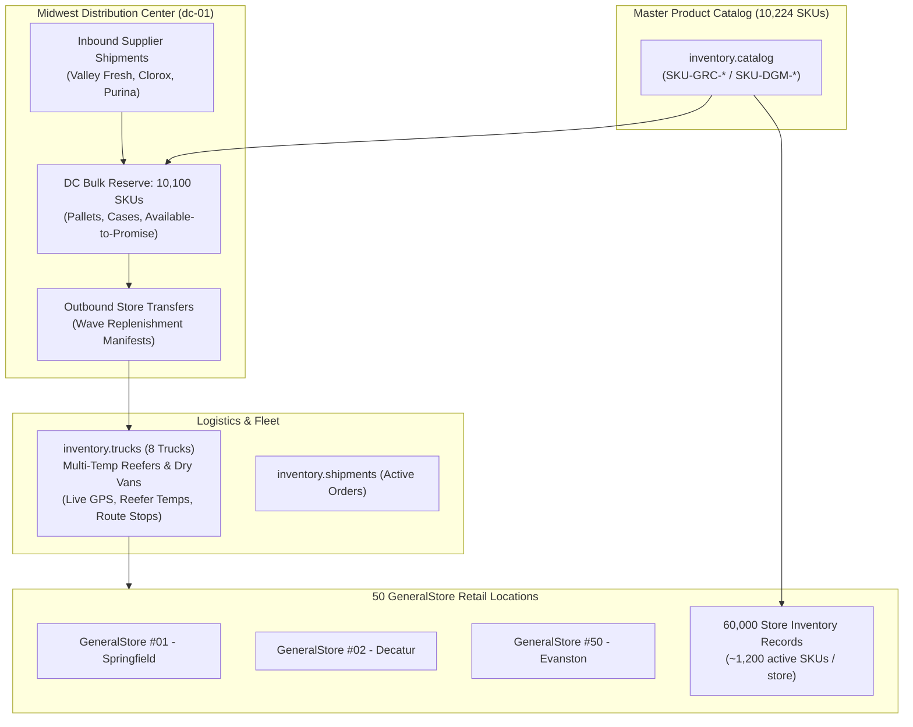

# Couchbase Capella Configuration & Integration Guide
## Celios / Nomad Agent Platform (Intepros)

This guide documents the Couchbase Capella database architecture, dataset schemas, secondary index governance, and count optimization mechanics prepared for **Jason Hunt (Intepros)** to connect the **Celios / Nomad** no-code agent deployment platform.

---

## 1. Cluster & Connection Details

| Property | Value | Notes |
|---|---|---|
| **Cluster Name** | `IntePros-CeliosNomad-TestCluster` | ID: `a7eed259-bd29-4eda-b512-5d095c68af35` |
| **Connection String** | `couchbases://cb.6acsrqvgndtvtmx.cloud.couchbase.com` | TLS Encrypted |
| **Provider / Region** | GCP `us-central1` | 3 Nodes (Data, Index, Query, Search, Eventing) |
| **Server Version** | Couchbase Server **8.0.3 Enterprise** | Storage Engine: **Magma** |
| **Network Access** | `0.0.0.0/0` (Active) | Reachable from any cloud agent runner or IDE |
| **Bucket** | `inventorycount` | Primary operational bucket |
| **Scope** | `inventory` | Domain scope for retail & supply chain |
| **Database Users** | `celios` (SuperUser)<br>`nomad` (data_reader, data_writer) | SuperUser for DDL/indexing; Nomad has bucket-level R/W across all collections |

---

## 2. Dataset Scale & Hierarchy

The database has been pre-seeded with enterprise retail and distribution center volume:



### Collection Inventory Breakdown:
* **`catalog` (10,224 Master Products)**:
  * Department split: 5,500 Grocery (`GRC`) items + 4,500 General Store Merchandise (`DGM`) items.
  * Formatted with consistent Master SKUs (`SKU-GRC-DAIR-00001`, `SKU-DGM-CLN-05501`) and check-digit valid 12-digit UPCs.
  * Enriched with **`search_text`** (`name | brand | department | category | subcategory | attributes`) ready for Vertex AI `text-embedding-005` vectorization.
  * Document ID: `catalogue::upc::{12-digit-upc}`
* **`proposals` (Nomad Agent Decision Engine)**:
  * Holds replenishment transfers, purchase orders, and cold-chain incident responses awaiting human approval.
  * Indexed by `idx_proposals_status(status, type)` and `idx_proposals_type(type, created_at)`.
  * Verified: user `nomad` has full read/write permissions.
* **`counts` (70,596 Inventory Documents)**:
  * **60,000 Store Inventory Records**: Stock on shelves across **50 `GeneralStore` locations** (`store_type: "GeneralStore"`).
  * **10,100 DC Bulk Records**: Reserve case/pallet stock at `dc-01` (`available_to_promise` units).
  * Document ID: `count::{store_id}::{sku}` (e.g. `count::store-001::SKU-GRC-DAIR-00001` or `count::dc-01::...`).
* **`locations` (2,244 Locations)**:
  * 1,800 GeneralStore department aisles, racks, shelves, and bins with QR payloads (`LOC::*`).
  * 12 DC dock doors, cold vaults, and high-bay pallet racking locations.
  * Document ID: `location::{site}::{aisle_shelf_bin}`.
* **`trucks` (8 Fleet Vehicles)**:
  * Multi-temp reefers and dry vans with live telematics (GPS, reefer temperature setpoints, speed, driver info, and assigned route stops).
  * Document ID: `truck::{truck_id}`.
* **`shipments` (5 Active Manifests)**:
  * Inbound supplier POs (Valley Fresh, Clorox, Purina) + Outbound store transfer manifests.
  * Document ID: `shipment::out::{id}` / `shipment::in::{id}`.

---

## 3. Index Architecture: Strictly Secondary GSIs (NO Primary Indexes)

Per production best practices, **all primary indexes (`#primary`) have been removed** from the cluster to prevent unindexed full-keyspace table scans. Every query must hit a secondary GSI:

| Collection | Index Name | Indexed Fields | Target Agent Workload |
|---|---|---|---|
| **`counts`** | `idx_counts_store_type_sku` | `(store_type, sku, stock_status)` | Multi-store rollups across the 50 GeneralStores |
| **`counts`** | `idx_counts_sku` | `(sku, stock_quantity, stock_status)` | Single SKU chain-wide availability & DC lookup |
| **`counts`** | `idx_counts_store_sku` | `(store_id, sku)` | Point-lookup for a specific store's inventory item |
| **`counts`** | `idx_counts_status` | `(stock_status, store_id)` | Stockout and low-stock exception filtering |
| **`catalog`** | `idx_catalog_sku` | `(sku)` | Join predicate on master SKU |
| **`catalog`** | `idx_catalog_upc` | `(code.value)` | Barcode lookup from scanners/mobile devices |
| **`catalog`** | `idx_catalog_cat` | `(category, department)` | Departmental category browsing & procurement |
| **`locations`** | `idx_locations_store` | `(store_id)` | Store planogram and aisle retrieval |
| **`locations`** | `idx_locations_site` | `(location.site)` | Facility location lookups |
| **`trucks`** | `idx_trucks_id` | `(truck_id)` | Fleet dispatch point lookups |
| **`trucks`** | `idx_trucks_status` | `(current_status)` | Active vehicle tracking (`en_route`, `at_dock`) |
| **`trucks`** | `idx_trucks_trailer` | `(trailer_type)` | Cold-chain reefer vs dry-van fleet filtering |
| **`shipments`** | `idx_shipments_dest` | `(destination.store_id, status)` | Pending and in-transit shipments for a store |
| **`shipments`** | `idx_shipments_truck` | `(assigned_truck)` | Vehicle manifest payload retrieval |
| **`shipments`** | `idx_shipments_status` | `(status, direction)` | Operational dispatch monitoring |

---

## 4. Count Optimization Mechanics: How Counts Work Without Primary Indexes

In Couchbase, the document-level `META()` object only contains document metadata (`id`, `cas`, `expiration`, `flags`, `type`) and does **not** store an arbitrary `META().count`.

Instead, Couchbase provides **two built-in count optimization engines** that Nomad agents can leverage for sub-millisecond execution:

### A. Index Count Pushdown (`index_group_aggs`)
When querying `COUNT(*)` with a `WHERE` filter matching a secondary index (e.g. by `sku` or `store_type`):
* The Indexer service calculates the aggregate count **directly inside the index B-tree**.
* **Zero KV document fetches**: It does not read documents from disk/memory.
* **Zero index item transport**: It does not transmit individual keys across the network.
* The query engine receives `cover (count(*))` directly from the Indexer.

**Live EXPLAIN Plan Evidence on `idx_counts_sku`:**
```json
{
  "#operator": "IndexScan3",
  "index": "idx_counts_sku",
  "index_group_aggs": {
    "aggregates": [
      {
        "aggregate": "COUNT",
        "expr": "1"
      }
    ]
  },
  "covers": [
    "cover (count(*))"
  ]
}
```

### B. Collection Metadata `CountScan` (Zero-IO)
When querying the count of an entire collection (`SELECT COUNT(*) FROM counts`):
* Even with **NO primary index**, Couchbase does not scan the keyspace.
* The query engine invokes the **`CountScan`** operator, which reads the collection's internal item counter directly from the storage engine metadata in microseconds.

**Live EXPLAIN Plan Evidence on whole collection count:**
```json
{
  "#operator": "CountScan",
  "bucket": "inventorycount",
  "scope": "inventory",
  "keyspace": "counts"
}
```

---

## 5. Sample SQL++ Queries for Nomad Agents

### Query 1: 50-Store Stockout Rollup with DC Bulk Reserve Check
> Evaluates inventory across all 50 `GeneralStore` locations to flag stockout clusters, comparing shelf stock directly against DC bulk reserve.

```sql
SELECT 
    c.sku,
    c.item_name,
    COUNT(CASE WHEN c.stock_status = 'out_of_stock' THEN 1 END) AS out_of_stock_stores,
    COUNT(CASE WHEN c.stock_status = 'low_stock'    THEN 1 END) AS low_stock_stores,
    COUNT(CASE WHEN c.stock_status = 'in_stock'     THEN 1 END) AS in_stock_stores,
    COUNT(CASE WHEN c.stock_status = 'overstocked'  THEN 1 END) AS overstocked_stores,
    SUM(c.stock_quantity)                           AS total_chain_shelf_stock,
    dc.stock_quantity                               AS dc_bulk_reserve
FROM `inventorycount`.inventory.counts c
LEFT JOIN `inventorycount`.inventory.counts dc 
    ON KEYS ('count::dc-01::' || c.sku)
WHERE c.store_type = 'GeneralStore' AND c.sku = 'SKU-GRC-DAIR-00001'
GROUP BY c.sku, c.item_name, dc.stock_quantity;
```

### Query 2: Fleet In-Transit Manifest Tracking
> Surfaces active trucks, current telematics (GPS / reefer temperature), and unnested shipment line items destined for stores.

```sql
SELECT 
    t.truck_id,
    t.name                         AS truck_name,
    t.driver.name                  AS driver,
    t.telematics.reefer_temp_f     AS reefer_temp,
    t.telematics.speed_mph         AS speed,
    s.shipment_id,
    s.destination.name             AS destination_store,
    s.status                       AS shipment_status,
    m.sku,
    m.name                         AS manifest_item,
    m.cases,
    m.total_units
FROM `inventorycount`.inventory.trucks t
JOIN `inventorycount`.inventory.shipments s 
    ON 'truck::' || t.truck_id = s.assigned_truck
UNNEST s.manifest AS m
WHERE t.current_status IN ['en_route', 'at_dock'];
```

---

## 6. Vector Search & Semantic Meaning (Completed)

Nomad has successfully generated embeddings and meaning-based search across all master products in `catalog`:
* **Embedding Model**: Vertex AI `text-embedding-005` (768 dimensions, `COSINE` similarity).
* **Indexed Fields**: `embedding` vector array and `embedding_hash`.
* **Vector Index**: Created directly in Couchbase by Nomad (`catalog_embedding_vec`).

---

## 7. App Services Mobile Sync & Replication (Live)

The Capella App Service and App Endpoint are fully online on GCP `us-central1`, providing bidirectional sync with continuous DCP import:

| Endpoint Property | Configuration |
|---|---|
| **App Service Name** | `celios-nomad-appservice` (`c5f63dff-e22e-4d66-a6cd-f638b2e21e60`) |
| **App Endpoint Name** | `inventorycount` (State: **Online**) |
| **Public WSS Replication URL** | `wss://gdpqyltlbvh5ubbb.apps.cloud.couchbase.com/inventorycount` |
| **Public REST API URL** | `https://gdpqyltlbvh5ubbb.apps.cloud.couchbase.com/inventorycount` |
| **Admin REST API URL** | `https://gdpqyltlbvh5ubbb-admin.apps.cloud.couchbase.com/inventorycount` |
| **DCP Import** | **ON** (All Couchbase Server SDK writes from Nomad & seed scripts stream to edge devices) |

### Synchronized Collections (Scope: `inventory`)
1. **`catalog`**: 10,224 Master Products with text & vector embeddings (routed to public `!` channel).
2. **`counts`**: 70,596 Store shelf counts & DC bulk reserves (routed to `admin`, team, and store channels).
3. **`locations`**: 2,244 Store bay locations & DC warehouse docks (routed to public `!` channel).
4. **`proposals`**: Nomad agent decision proposals (replenishment transfers, POs, alerts; routed to `!`, `team`, `admin`).
5. **`trucks`**: Fleet vehicles with real-time telematics, GPS, and cold-chain reefer temperatures (routed to public `!`).
6. **`shipments`**: Inbound POs and outbound store replenishment delivery manifests (routed to `!` and destination store channels).

### Mobile App User Credentials
* **Store Manager / Admin App User**:
  * **Username**: `manager`
  * **Password**: `Password1!`
  * **Role**: `admin` (Has wildcard channel access `*`, `admin`, and `!` across all 6 collections).
* **Field Operator / Store Associate App User**:
  * **Username**: `bob`
  * **Password**: `Password1!`
  * **Assigned Channels**: `bob`, `crew-a`, `dc-logistics`, and public `!`.

